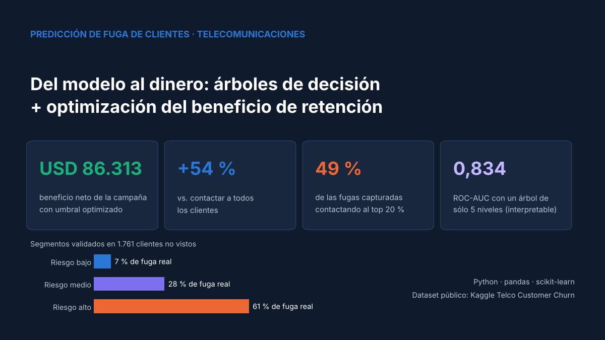
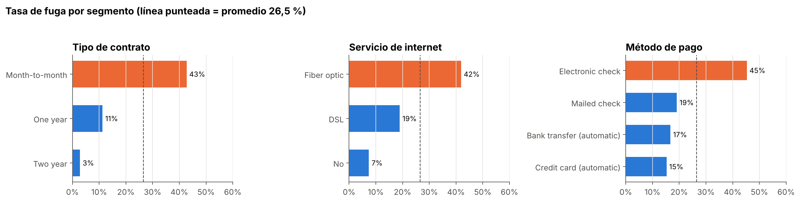
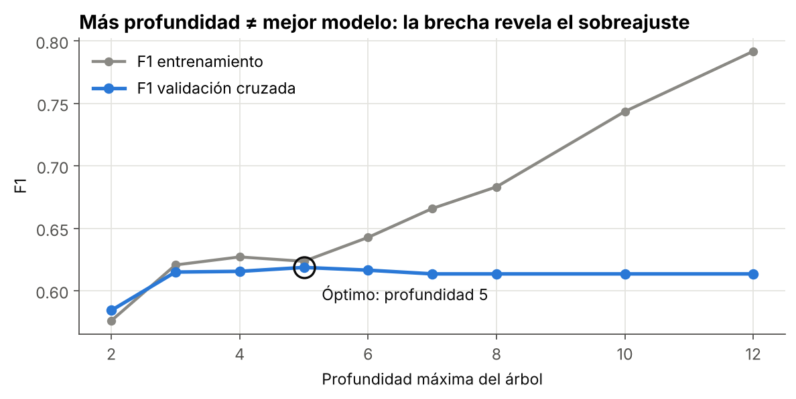
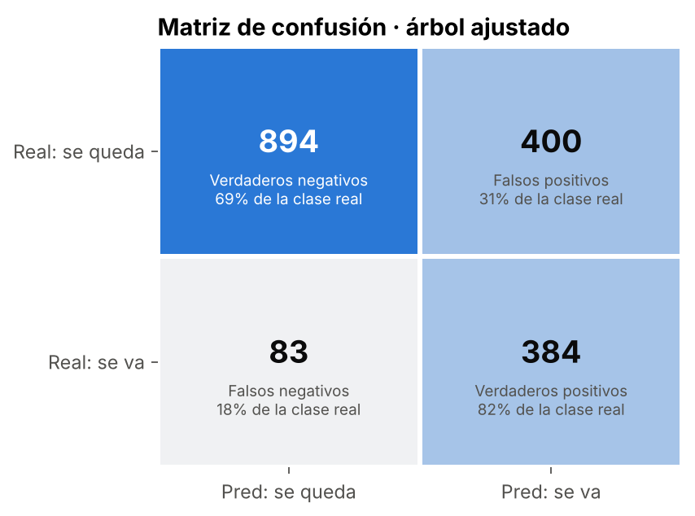
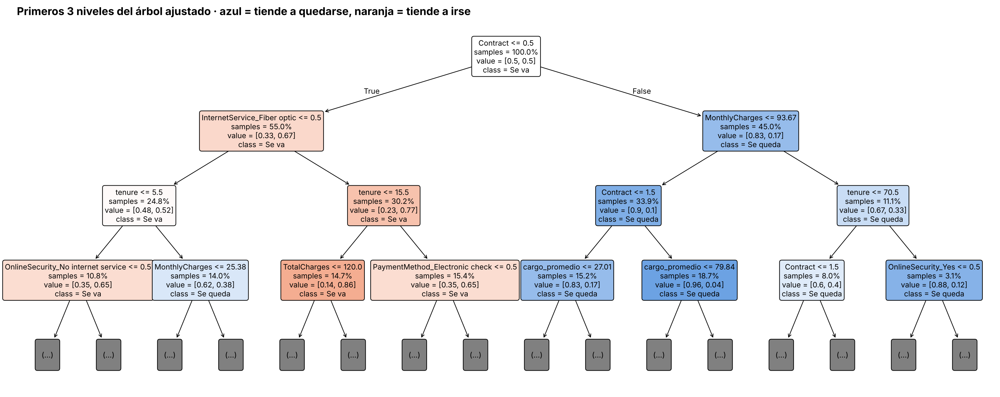
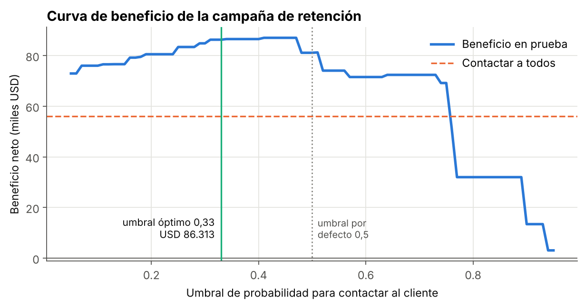
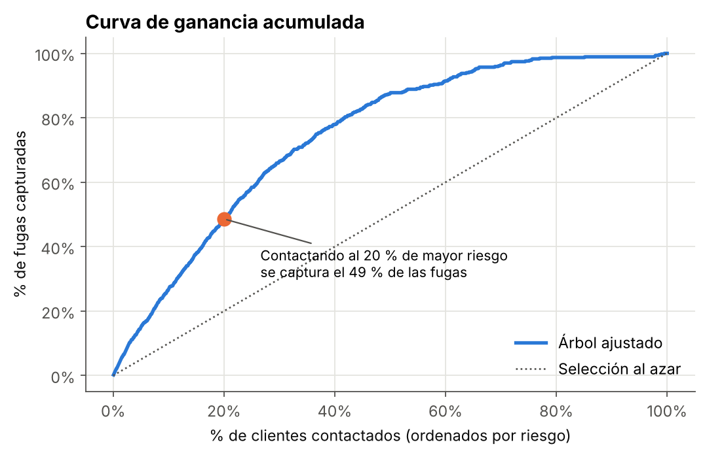
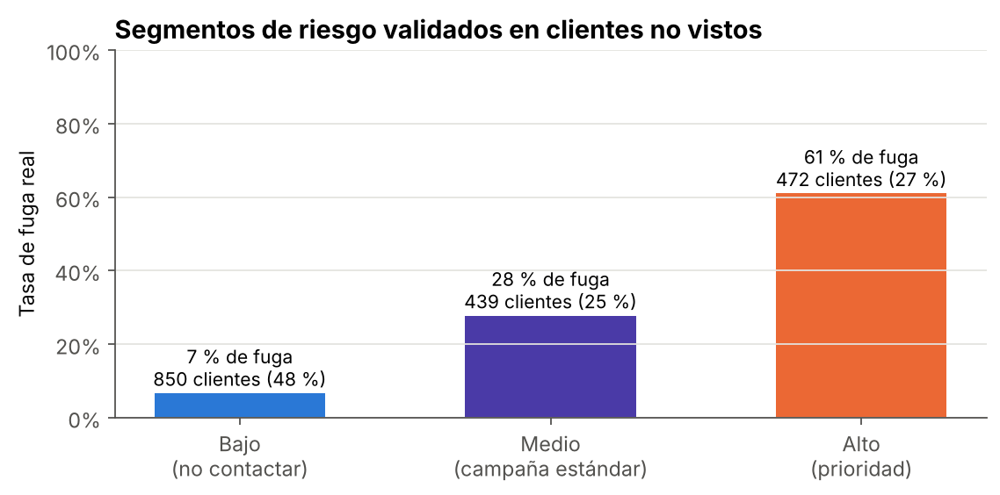
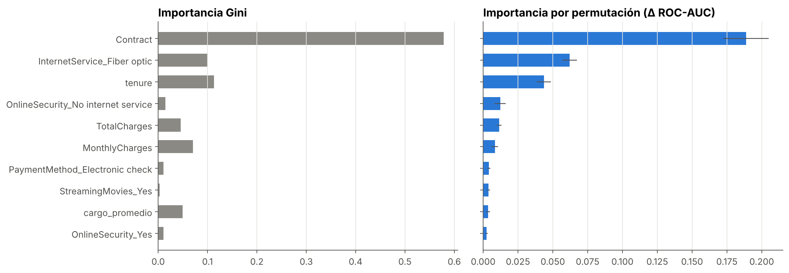

# 📉 Predicción de fuga de clientes (Churn) en Telecomunicaciones

> **Del modelo al dinero:** árboles de decisión interpretables + optimización del umbral de decisión según el beneficio económico de una campaña de retención.




---

## 🎯 Problema de negocio

Una compañía de telecomunicaciones pierde **1 de cada 4 clientes** (26,5 %). El área comercial necesita responder tres preguntas:

1. **¿Quién se va a ir?** → modelo de clasificación.
2. **¿Por qué se va?** → reglas interpretables que el equipo comercial pueda leer.
3. **¿A cuántos clientes conviene llamar?** → umbral elegido para **maximizar el beneficio**, no la exactitud.

## 📊 Resultados principales

| Indicador | Resultado |
|---|---|
| Beneficio neto de la campaña con umbral optimizado | **USD 86.313** (vs. USD 56.075 contactando a todos: **+54 %**) |
| Mejora frente al umbral por defecto de 0,5 | **+USD 5.168** (+6,4 %) sin cambiar el modelo |
| Fugas capturadas contactando al 20 % de mayor riesgo | **49 %** (lift de 2,4×) |
| ROC-AUC del árbol ajustado (5 niveles, 31 hojas) | **0,834**, sólo 0,015 por debajo del mejor modelo de caja negra |
| Recall del árbol ajustado | **82 %** de los clientes que se van son detectados |

_Todas las cifras se miden sobre un conjunto de prueba de 1.761 clientes que el modelo nunca vio._

## 🔍 Hallazgos clave



- **El tipo de contrato es el factor más importante:** contrato mes a mes = 43 % de fuga; contrato a 2 años = 3 %.
- **La fibra óptica** (42 %) y el **pago con cheque electrónico** (45 %) concentran el riesgo.
- **Los primeros meses son críticos:** los clientes que se van son, en su mayoría, nuevos y con cargos mensuales altos.

## 🌳 Un árbol podado es casi tan bueno como una caja negra

| Modelo | Accuracy | Precision | Recall | F1 | ROC-AUC | PR-AUC |
|---|---|---|---|---|---|---|
| Regresión logística | 0,748 | 0,516 | 0,803 | 0,628 | **0,849** | **0,657** |
| Random Forest | **0,770** | **0,545** | 0,801 | **0,649** | 0,847 | 0,652 |
| Gradient Boosting | 0,758 | 0,529 | 0,769 | 0,627 | 0,837 | 0,637 |
| **Árbol ajustado** ⭐ | 0,726 | 0,490 | **0,822** | 0,614 | 0,834 | 0,619 |
| Árbol base (sin poda) | 0,746 | 0,522 | 0,514 | 0,518 | 0,672 | 0,398 |

El árbol sin restricciones crece a **972 hojas** y sobreajusta (99,8 % en entrenamiento vs. 74,6 % en prueba). Con `GridSearchCV` (216 combinaciones × 5 particiones = 1.080 entrenamientos) se obtiene un árbol de **5 niveles** que generaliza bien y se puede explicar en una reunión.

<p align="center">
  
  
</p>



## 💰 Valor agregado: del modelo al dinero

El umbral de 0,5 que viene por defecto es arbitrario. Con un modelo económico explícito (costo de la oferta USD 50, tasa de éxito 35 %, 12 meses de ingreso retenido), el umbral se elige **con predicciones de validación cruzada sobre el entrenamiento** y se valida en prueba:



<p align="center">
  
  
</p>

El resultado es una **segmentación accionable**: el segmento de riesgo alto (27 % de los clientes) tiene un **61 % de fuga real**, mientras que el de riesgo bajo (48 %) tiene sólo un 7 %. La lista priorizada se exporta en [`reports/clientes_prioritarios.csv`](reports/clientes_prioritarios.csv).

## ✨ Qué diferencia este análisis de un tutorial típico

- 🕵️ **Valores faltantes ocultos:** `isna()` reporta cero, pero `TotalCharges` tiene 11 espacios en blanco. Se diagnostica la causa (clientes con `tenure = 0`) en vez de eliminar filas a ciegas.
- 🧱 **Variables de negocio nuevas:** número de servicios contratados, gasto promedio mensual y bandera de cliente nuevo.
- ⚖️ **Desbalance de clases** tratado con `class_weight` dentro de la búsqueda de hiperparámetros y división estratificada.
- 📏 **Métricas apropiadas:** ROC-AUC y PR-AUC además de accuracy, que aquí engaña (73,5 % prediciendo siempre "se queda").
- 🔬 **Importancia por permutación** frente a la importancia de Gini, que está sesgada hacia variables continuas.
- 💵 **Umbral óptimo por beneficio**, curva de ganancia acumulada y segmentación de riesgo validada.
- 🚫 **Sin fuga de información:** el umbral se elige con `cross_val_predict` en entrenamiento; el conjunto de prueba se usa sólo para la evaluación final.



## 🧠 Recomendaciones al negocio

1. **Migrar clientes de contrato mensual a anual** con incentivos durante los primeros 6 meses.
2. **Incluir soporte técnico y seguridad online** en planes de fibra óptica como herramienta de retención.
3. **Promover el pago automático** (tarjeta o transferencia) en lugar del cheque electrónico.
4. **Lanzar la campaña mensual** sobre los segmentos de riesgo alto y medio usando la lista priorizada.

## 🗂️ Estructura del repositorio

```
churn-prediction-telco/
├── data/                       # Dataset (no versionado, ver data/README.md)
├── images/                     # Gráficos generados por el notebook
├── notebooks/
│   └── analisis_churn_telco.ipynb
├── reports/
│   ├── comparacion_modelos.csv
│   ├── segmentos_riesgo.csv
│   ├── clientes_prioritarios.csv
│   └── modelo_arbol_churn.joblib
├── requirements.txt
├── LICENSE
└── README.md
```

## ▶️ Cómo reproducirlo

```bash
git clone https://github.com/Cristobal-111/churn-prediction-telco.git
cd churn-prediction-telco
pip install -r requirements.txt
# Descarga el CSV de Kaggle en data/ (opcional: si no está, el notebook lo lee desde la fuente pública de IBM)
jupyter notebook notebooks/analisis_churn_telco.ipynb
```

También puedes abrirlo directamente en Google Colab: [](https://colab.research.google.com/github/Cristobal-111/churn-prediction-telco/blob/main/notebooks/analisis_churn_telco.ipynb)

## ⚠️ Limitaciones y próximos pasos

- Los supuestos económicos son **ilustrativos**: en un caso real deben calibrarse con datos históricos de campañas o con un test A/B.
- Con `class_weight="balanced"` el score ordena bien el riesgo, pero no es una probabilidad calibrada (`CalibratedClassifierCV` lo resolvería).
- Siguiente nivel: **modelos de uplift** para identificar a quién *cambia* la oferta, no sólo a quién está en riesgo.

## 📚 Fuente de datos

[Telco Customer Churn — Kaggle](https://www.kaggle.com/datasets/blastchar/telco-customer-churn) · Datos de muestra publicados por IBM. 7.043 clientes, 21 variables.

- 🏨 [Predicción de cancelaciones hoteleras con Random Forest](https://github.com/Cristobal-111/hotel-cancellation-random-forest)
  
## 👤 Autor

**Cristobal Rojas** · Analista de Datos
[LinkedIn](https://www.linkedin.com/in/cristobal-rojas-troncoso/) · [GitHub](https://github.com/Cristobal-111)
